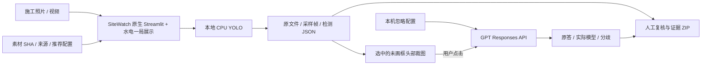

# 当前架构

业务范围是施工影像安全监测演示：本地 YOLO 初筛、GPT 头部复核、人工查看与证据导出。优先复现完整 SiteWatch 应用，保留上游源码与许可；`sitewatch/app` 的薄适配由 `sitewatch/patches/local-review.patch` 重建。`verify_provenance.py` 核对原始 27 文件与适配副本。

## 模型和素材

SiteWatch 为 YOLOv8m PPE、25 目标类；Constructelligence v0.3 为 14 类近景候选。固定来源/revision/哈希与类别在 `SOURCE.json`、`model-candidates.json`。远景模式可加载固定 YOLOv8n，只补人员类别；不代替安全帽模型。默认只展示人员与 PPE，完整真实输出留在 JSON；模型未加载、校验失败均明确报错，无静默替代或人工造框。

素材库 `demo-media.json` 为三视频、三照片，按条目选择实测模型与尺度。默认实际结构作业视频使用 SiteWatch standard；两条 4K 近景与两张高清照片使用 Constructelligence；砌筑对照照片使用 SiteWatch，展示原检测与区域第二意见的分歧。来源元数据不送入检测器，导出按原件 SHA 匹配 `media-sources.json`。轨道原件保留，撤下两个菜单入口。采样复核不运行运动、距离、形状或缺失装备推断规则。

## GPT API 与状态

只支持 `openai` provider，默认 `gpt-6.1-sol` / `max`，固定头部 A/B/C/D 问题。Key 只在 `config/review-api.local.json`，不从其他项目取值，不进入证据。状态查询不触网；实际调用传原裁图、`store:false`，单次请求、不自动重试、不跟随重定向。失败保存脱敏 attempt，原检测保持；结果记录实际模型、配置快照与响应信息。素材、检测模型/参数、推理尺度变化隔离旧显示；修改本机 GPT 配置不会主动隐藏已有意见，历史调用来源保存在证据中。前台使用业务名称和中性复核说明，不展示具体供应商或部署位置，不声明复核为本地运行。开源来源及许可证继续提供。接口见 [head-review-api-v2](../contracts/head-review-api-v2.md)。

本地 Qwen 模块、量化权重、Gradio/Transformers/bnb 安装及 full profile 已移除。历史记录仅说明曾做过的比较，不再提供可启动入口。

## 环境与交接

Git 只保存精简源码、文档、契约与小份证据。`config/runtime-assets.json` 固定 11 资源包/41 附件/209 份可分发文件及 5 份官方外部素材。模型与允许再分发素材走 Release；Pexels 原件按条款从官方恢复。`ppe` 为 CPU，`--include-training` 为可选 RF100 90 图测试子集等，不构成完整训练集。

`.runtime/portable-env` 是隔离 CPU 环境；`.runtime/sitewatch-env` 为相对链接，管理器固定在本机 8767，只启动/停止归属验证通过的本项目进程。运行数据在 `.runtime/sitewatch-env/runtime/`，上传、视频、逐帧 PNG 与证据包均忽略；任何迁移先保留 `runtime` 并核 SHA。关机后需手动启动，移动项目后重建环境。API Key 与 GitHub 授权独立于模型环境，禁止清理或发布。

品牌 PNG 与 CSS 本地加载，来源与哈希登记于 `sitewatch/branding/SOURCE.json`。页面显示真实帧数、待复核框次数与耗时，不将目标类别数解释为业务功能数。

旧材料台账是已停止的技术试跑；其他 Agent 工作区不在本项目修改范围。
