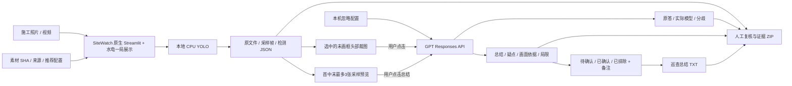

# 当前架构

业务范围是施工影像安全监测演示：本地 YOLO 初筛、ByteTrack 对象轨迹与候选区域事件、GPT 头部复核、AI 巡查总结、人工确认与证据导出。优先复现完整 SiteWatch 应用，保留上游源码与许可；`sitewatch/app` 的薄适配由 `sitewatch/patches/local-review.patch` 重建。`verify_provenance.py` 核对原始 27 文件与当前适配 Python 文件。

## 轨迹与候选区域事件

检测完成后，`tracking.py` 从保存的 `detections.json` 读取人员/设备框，调用 Ultralytics 的 ByteTrack 适配器生成 `tracks.json` 和轨迹叠加图；原检测不被重写。`tracking_ui.py` 提供当前画面矩形候选区域输入，`save_zone_events` 生成 `events.json` 中的进入、停留和离开候选事件，并保留关键帧、时间和 `pending` 状态。区域坐标仅是检测画面像素，未经标定不转换为米。

如果存在候选事件，AI 巡查总结会优先选取事件关键帧，并把事件类型、对象 ID 和画面位置作为检测参考；模型不得输出 ID 或人工状态，最终仍由服务端分配问题编号、人工状态和报告。跟踪和区域事件均为本次 review 目录内的候选记录，不代表员工身份、跨摄像头跟踪或生产告警。契约见 [轨迹事件](../contracts/tracking-events-v1.md)。

## 原图局部复核与连续回放（V20）

`object_review_ui.py` 复用当前 Streamlit 页面，通过轻量本地 `reviewer-component/index.html` 发送所选检测索引或人工矩形。`object_review.py` 按 `detection_dimensions_wh` 将检测坐标映射回原始照片/视频解码帧，保存无框 PNG；“头部参考”和“上身参考”仅按人员框位置裁剪，不当作装备识别。人工目标、帽、衣状态及备注独立保存在 `object-reviews/decisions.json`，保留历史及裁图 SHA，不修改检测 JSON。

关键帧导航只索引同一检测 SHA 下的候选区域事件、巡查总结依据，并核对真实帧号与文件名。旧的无 SHA 事件仍可查看原表格，重新生成后支持定位。ByteTrack 适配器保留进程内单调 ID 分配，防止新建跟踪实例重置其他会话的活跃轨迹。

`video_replay.py` 逐帧调用同一真实检测器与 ByteTrack，流式写 `frames.jsonl`，用 `imageio-ffmpeg==0.6.0` 提供的 FFmpeg 编码独立 H.264 MP4；不根据标注或采样框插值造连续检测。帧数、模型/原片/逐帧证据 SHA 校验通过后才发布 `video-replay/replay.json`，保留原视频。回放只覆盖当前分析时长，轨迹 ID 为回放内 ID。CPU 串行处理、低延迟编码限制内存；视频播放、裁图放大与人工保存无外部 API 调用。

标注页的显示筛选独立于标签数组；服务端校验版本、归一化坐标并原子保存，在本地 `label-history/` 保留旧标签。完成进度单独存 `annotation-progress.json`，不会把隐藏人员框删掉。标注、视频、权重和截图均在忽略目录内。

## 模型和素材（检测基线）

甲方室外远景与脚手架条目当前默认 `client-person-demo` 单类别人员适配权重，固定640输入、不叠加COCO人员分支。帽衣自动识别等待补标训练，局部窗口目前可先保存人工意见；山路货车保留通用SiteWatch。

SiteWatch 为 YOLOv8m PPE、25 目标类；Constructelligence v0.3 为 14 类近景候选。固定来源/revision/哈希与类别在 `SOURCE.json`、`model-candidates.json`。远景模式可加载固定 YOLOv8n，只补人员类别；不代替安全帽模型。默认只展示人员与 PPE，完整真实输出留在 JSON；模型未加载、校验失败均明确报错，无静默替代或人工造框。

素材库 `demo-media.json` 当前为六视频、三照片，含三段甲方本地视频，按条目选择实测模型与尺度。默认实际结构作业视频使用 SiteWatch standard；两条 4K 近景与两张高清照片使用 Constructelligence；砌筑对照照片使用 SiteWatch，展示原检测与区域第二意见的分歧。来源元数据不送入检测器，导出按原件 SHA 匹配 `media-sources.json`。轨道原件保留，撤下两个菜单入口。采样复核不运行运动、距离、形状或缺失装备推断规则。

## GPT API 与状态

只支持 `openai` provider，默认 `gpt-6.1-sol` / `max`，固定头部 A/B/C/D 问题。Key 只在 `config/review-api.local.json`，不从其他项目取值，不进入证据。状态查询不触网；实际调用传原裁图、`store:false`，单次请求、不自动重试、不跟随重定向。失败保存脱敏 attempt，原检测保持；结果记录实际模型、配置快照与响应信息。素材、检测模型/参数、推理尺度变化隔离旧显示；修改本机 GPT 配置不会主动隐藏已有意见，历史调用来源保存在证据中。前台使用业务名称和中性复核说明，不展示具体供应商或部署位置，不声明复核为本地运行。开源来源及许可证继续提供。接口见 [head-review-api-v2](../contracts/head-review-api-v2.md)。

本地 Qwen 模块、量化权重、Gradio/Transformers/bnb 安装及 full profile 已移除。历史记录仅说明曾做过的比较，不再提供可启动入口。

## AI 巡查总结与人工记录（V15）

`safety_summary.py` 只读本次 `detections.json` 和未画框采样输入，选择首、中、末最多 3 个唯一位置，另存最长边 1280 的 PNG 预览。Responses 单次多图请求附真实时间、尺寸和检测参考；原件与原检测不改。头部仍为固定裁图 A/B/C/D，总结独立使用 `summary_max_output_tokens=8192`，头部预算仍 4096；默认 Sol / Max 不变。仅按钮触发请求，人工保存、普通 rerun、导出均不触网。

模型只能返回 overview/observations/limitations/findings，以及每项 title/detail/suggestion/frame_positions。服务端严格校验字段、数量和证据范围，再分配 ID、时间和初始 `pending`。未检出不等于缺失、零疑点不等于全程安全，不推测精确距离或隐藏设备。`safety_summary_ui.py` 安全显示纯文字，状态和备注仅在显式保存时落盘；不同任务/总结版本隔离，过期版本拒绝保存。

每个 review 的 `safety-summary/attempts` 保存不可变原答、实际来源、输入 SHA 与耗用；`latest-attempt.json` 与 `latest-success.json` 分开，失败保留旧成功。`decisions/<summary_id>.json` 独立保存人工状态、备注及时间历史，重新总结不继承旧决定。原子替换、线程/文件锁及报告回滚保证保存一致；主页面在 `summary_export_lock` 内校验 TXT 并读取 ZIP，报告更新失败不提供过时包。技术 JSON 留真实模型来源，不含 Key。

这是本机按任务保存的人工记录，不含登录权限、派单、整改销项或历史任务列表；主页面新检测会建立新任务，不能承诺关闭页面后自动找回选中任务。接口与边界见 [总结契约](../contracts/safety-summary-v1.md)，验证见 [V15](validation/V15_SAFETY_SUMMARY.json)。

## 环境与交接

Git 只保存精简源码、文档、契约与小份证据。`config/runtime-assets.json` 固定 11 资源包/41 附件/209 份可分发文件及 5 份官方外部素材。模型与允许再分发素材走 Release；Pexels 原件按条款从官方恢复。`ppe` 为 CPU，`--include-training` 为可选 RF100 90 图测试子集等，不构成完整训练集。

`.runtime/portable-env` 是隔离 CPU 环境；`.runtime/sitewatch-env` 为相对链接，管理器固定在本机 8767，只启动/停止归属验证通过的本项目进程。运行数据在 `.runtime/sitewatch-env/runtime/`，上传、视频、逐帧 PNG 与证据包均忽略；任何迁移先保留 `runtime` 并核 SHA。关机后需手动启动，移动项目后重建环境。API Key 与 GitHub 授权独立于模型环境，禁止清理或发布。

品牌 PNG 与 CSS 本地加载，来源与哈希登记于 `sitewatch/branding/SOURCE.json`。页面显示真实帧数、待复核框次数与耗时，不将目标类别数解释为业务功能数。

旧材料台账是已停止的技术试跑；其他 Agent 工作区不在本项目修改范围。
