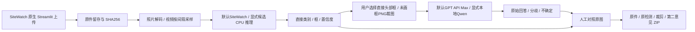
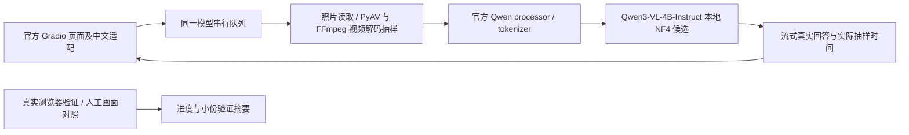
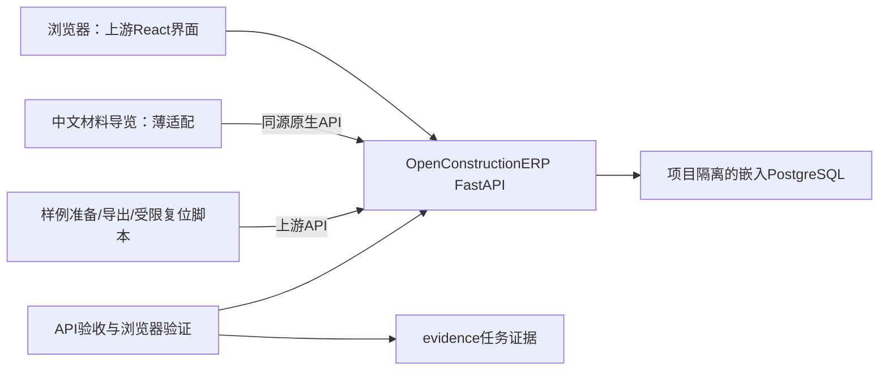

# 架构说明

## 资源与可移植环境

公开 Git 仓库保存源码、契约、来源许可与小份验证摘要；运行资源通过 `config/runtime-assets.json` 固定目标路径、字节数和 SHA256。允许再分发的模型、视频与可选数据放在 `runtime-20261107-v1` Release，资源可用性以正式发布为准；4 份受独立分发限制的 Pexels 原片从原站按清单下载并校验。大附件不进入 Git 历史。

`restore_runtime_assets.py` 支持 PPE、full 和可选训练相关资源，校验 ZIP 白名单成员、分片及拼接后权重；已有异内容目标拒绝覆盖。RF100 交接仅包含已保存的 90 图测试子集与标签，没有完整 train/valid 数据。`bootstrap_runtime.py` 在 `.runtime/portable-env/` 建立项目隔离环境，`.runtime/sitewatch-env/bin/python` 和 full 的 `vision/.venv/bin/python` 为项目内相对链接；新安装不引用原机的外部包目录。Linux x86_64 / Python 3.12 为迁移基线，Torch 2.8.0 / torchvision 0.23.0 分 CPU、cu128 安装。步骤与验证边界见[新目录运行说明](RUNTIME_SETUP.md)，尚无完整新机 GPU 业务验收结论。

## 当前：施工影像 PPE 检测复核

默认采用本机YOLO检测＋GPT-6.1 Sol Max API局部复核。选中头部的未画框PNG与固定问题发送到本机配置的Responses接口；模型名和推理强度分开配置，Key仅在忽略文件`config/review-api.local.json`保存。API模式不依赖Qwen权重或GPU，`ppe`环境足够；显式`qwen_local`保留原Qwen3-VL-4B NF4路径。接口见[复核API契约](../contracts/head-review-api-v2.md)与[填写Key说明](GPT_API_SETUP.md)。缺Key不触网，状态已配置不等于已验证，实际回答和来源逐次保存。

V11仅为现有页面加品牌与中文展示：官网组合PNG按原字节本地保存，`sitewatch/branding/SOURCE.json`记录来源与SHA；CSS与logo本地嵌入，不依赖外部字体/图像请求。流程引导是操作说明，统计卡仅从本次真实result取帧数、待复核框次数与耗时。文件与模型输出字段保持V10契约。模型资源缓存最多两组参数变体，断开会话过期门槛60秒且按惰性缓存机制淘汰；不保证关页60秒即释放内存，也不清理全局模型缓存。此项限制缓存项数，不代表对Torch/大图下载总内存设置硬上限。

V10增加本地demo-media清单：id/路径/字节/SHA/署名许可/实测推荐模型与profile。UI分开保留自己上传和素材库入口，选择时校验root路径及原字节；auto解析到真实model/profile，手动覆盖优先，源信息只用于署名。显示模式不参与推理签名；素材、画质、模型/尺度变化清旧检测和Qwen结果。

`review_file(preserve_resolution=True)`保留解码原尺寸，不增强，PNG输入与解码像素相同，所有标注也按原尺寸保存；默认False维持旧路径兼容。相同像素文件允许别名。原生大文件位于 runtime，Git 仅保留必要的小份验证摘要；运行截图和大证据输出不随源码提交。下载分别返回未处理原件、原尺寸输入PNG、当前框图。字号scale只影响绘图，不改源图/置信分数。契约见hd-demo-media-v1.md。

2026-11-07按用户允许固定素材调参/过拟合的演示目标新增预设。`Detector(profile='standard')`固定原PPE640；`distant`复用原生PPE1280＋官方COCO640只输出person，按上游IoU仅对整人框去重，帽框不压掉整人。每次结果保存去重前`model_branches`、各自SHA/来源与最终显示框；COCO不生成帽类。缺/坏专用或辅助权重明确失败，不能静默回退。

自己上传的默认auto为照片标准、视频远景；素材库auto按条目推荐模型与预设。模式参与资源缓存和结果签名，切换清显示引用。默认review-overlay含人员与PPE，原PPE-only/all-overlay继续保存。缓存模型由锁保护，`detect_frame()`在锁内返回本次框/分支快照/耗时，证据保存不读跨会话可变last状态。此轮只做固定样例配置，无权重训练；镜头/场景泛化不作为演示验收门槛。

Qwen 通用问答技术复现完成但隐患业务不通过，因此在同一已批准影像复核范围内复现完整开源应用 [SiteWatch](https://github.com/AitchEm-bot/sitewatch)。保留其 Streamlit 上传界面、YOLO 专用检测器及画框流程，薄适配负责 CPU 配置、严格校验权重、采样记录和证据导出。独立worktree的实现已合入主分支；主智能体另行完成真实网页、源码/补丁及生命周期验证，历史大证据已按用户要求清理，保留结论见[进度记录](PROGRESS.md)和[资源保留说明](ASSET_RETENTION.md)。

专用权重不可用时明确失败，禁止回退普通 COCO 后仍宣称 PPE 检测成功。离线复核不运行距离、运动和形状规则，不由未检出正类推断缺少装备。所有 NO-* 来自模型自身训练类别，仍需现场人员确认；视频只对列明的采样帧负责，时间由帧序号/容器 FPS 估算。源码、权重及素材分别保留许可，PPE固定使用CPU；默认GPT复核走外部API，显式本地Qwen才使用GPU。页面默认显示人员与 PPE，完整类别框及误检仍保留；模型初筛有成功实例，但零检出和误判确实存在，自动违规判定未通过验证。

入口 `http://127.0.0.1:8767`；根目录启动/停止 `.cmd` 调用 `scripts/manage_ppe.py`。管理器以绝对启动参数、进程启动时刻、文件锁及独立进程组核验归属；重复启动等待健康，不接管未知端口；停止须等待端口释放。原件、采样、框图和来源许可在 `.runtime/sitewatch-env/runtime/reviews/`，成功时下载完整ZIP；失败时保留已完成证据并明确报错。结果文件契约见 [ppe-review-v1.md](../contracts/ppe-review-v1.md)。

V07比较固定四模型及已下载的 RF100 90 图测试子集。无模型通过已声明的全部实拍门槛，默认未替换；侧栏可显式选择Constructelligence v0.3对照。Detector的cache和本次输入签名均含model_id，严格核对模型SHA/实际names，界面类别数和来源随选择更新；输入、模型或配置改变清除session显示引用，历史证据文件保留。

`region_review.py`仅使用直接Hardhat/NO-Hardhat等头部框，四边20%padding并夹紧，不从person猜头位置。crop读取保存的未画框采样帧并输出PNG裁图，记录真实输入SHA；兼容模式输入可能为JPEG，原片保留模式为PNG。API模式的`backend_status`只读配置并返回未进行连通验证的状态；用户点击后单次发起Responses图像请求，无自动重试。显式本地模式的`backend_status`核对Qwen启动参数、PID持有的精确loopback监听socket及固定4B NF4权重SHA；只调用已归属的8766本地官方`/add_file`和`/submit_and_predict`。每次新会话，禁用telemetry，不传检测类别/预期答案。上传/生成等待30/120秒，取消后台best effort。接口见 [head-review-v1.md](../contracts/head-review-v1.md)。

第二意见原文和attempt写入`head-reviews/`，原始`detections.json`不修改；分歧只为两模型意见对照，不作法规判定，Qwen分类置信度为null。嵌套crop/原答/来源均递归包含在ZIP中。根启动.cmd按provider调度，API模式不启动Qwen；Key缺失或本地服务未就绪时只禁用区域复核，检测可独立使用。根停止入口保留对既有归属进程的释放。

## 辅助对照：Qwen 施工影像问答

复现 Qwen3-VL 官方 `web_demo_mm.py`，保留 Gradio 上传、对话和 HF 真实推理。`vision/upstream/` 保存未改原版；`vision/web_demo_mm.py` 为适配版；`vision/local_support.py` 处理本机资源限制、视频解码、提示和实际采样记录。输入为一张施工照片或一个短视频，输出为可见作业描述、待人工复核线索及不确定事项，没有独立隐患规则引擎或预写识别答案。

- 运行环境：新 clone 使用项目内 `.runtime/portable-env/`，full 安装后 `vision/.venv/bin/python` 指向它；无需旧机器的 `.pth` 外部 Torch 引用。原机环境记录仅描述历史运行。模型和公开素材在项目 `downloads/`，日志、视频规范化缓存和 Gradio 临时文件在 `.runtime/`，不进 Git。
- 模型来源：4B 官方逐文件锁在 [qwen4b-files.json](../vision/config/qwen4b-files.json)，13 文件哈希曾全部通过，该锁记录原始模型而非量化结果；当前 NF4 以 `config/runtime-assets.json` 的实际文件哈希校验，位于 `downloads/qwen3-vl-4b-nf4`。量化视觉与语言线性层，FP16计算，权重2,874,045,174字节，见 [量化记录（记录已清理）](ASSET_RETENTION.md)。按用户清理磁盘要求，已移除可重新下载的2B/4B原始大权重，保留小配置、全部来源证据及2B/4B NF4；重新量化须先恢复原始权重。启动器要求配置、tokenizer和权重齐全才选择模型，优先4B NF4，再回退2B NF4/原始，避免只剩配置被误认为可用。清理记录见 [C01（记录已清理）](ASSET_RETENTION.md)。
- 当前网页配置：单次仅一个图像/视频；视频≤60秒且≤200MB，16 帧，总像素预算 `16×448²`；图片预算 `1024²`；最大生成 384 tokens，提示为 [review-prompt-neutral.txt](../vision/config/review-prompt-neutral.txt)。预算经 processor 按比例缩放和取整，不是固定长边。最终网页 14 项技术检查、两照片及照片追问均完成，隐患业务不通过。命令行 4B probe 为 16 帧/512/v2 提示，两组结果分别取证。
- 并发与状态：首问和追加问题为原子队列事件，上传、载入新片、清空、重试共享`vision-model`并发组；底层GPU锁覆盖预处理、生成线程及结束清理，取消后等待生成结束再释放。
- 素材入口：[samples.json](../vision/config/samples.json) 含三视频、两近景照片。页面独立显示作者、来源和许可；`load_example` 只将媒体路径及通用问题加入对话，作者说明、标题和人工观察不作为模型答案输入。图片补充近景细节，不能据此替代视频动作验证。
- 证据：实际抽样时间由解码器返回，不由模型编造；按帧序号/平均帧率估算，可变帧率有偏差。它只证明读取了哪些画面，不证明风险定位准确。2B 网页 14 项技术检查通过和 4B 命令行生成完成均不能代替本轮业务验收；目前仍漏远景吊运，隐患判断不通过。
- 访问：专属后台管理脚本只启动/停止本项目服务，默认 `127.0.0.1:8766`；Windows `.cmd` 调用 WSL 后打开默认浏览器，关闭页面不会停止模型。进程记录为 `.runtime/vision-process.json`，日志为 `.runtime/vision-server.log`；与历史材料服务和其他 Agent 工作区分离。

## 历史材料试跑架构

## 原则与应用边界

采用“上游完整应用＋演示配置/数据＋验证脚本”。已实际采用 OpenConstructionERP 19.0.0 官方发行，保留原生React界面、FastAPI、PostgreSQL、ledger和权限。中文静态导览通过同源原生API呈现四步，不实现新的库存存储或计算。

## 目录与所有权

| 路径 | 内容 | 负责方 |
|---|---|---|
| docs/、AGENTS.md | 目标、架构、进度、决策、运行说明 | 主智能体 |
| contracts/ | 固定上游实际API、字段映射、版本与错误约定 | 主智能体冻结 |
| scripts/ | 安装、启动/停止、样例导入/复位、导出 | 按派发任务限定 |
| tests/ | 业务断言、浏览器自动操作 | 验证任务 |
| config/、fixtures/ | 明确标注的合成项目/材料与演示配置 | 数据适配任务 |
| evidence/ | 命令结果、接口结果、截图、审查及验收结论 | 每任务独立子目录 |
| .runtime/ | DB、日志、PID、临时导出；不进Git | 仅主集成运行管理 |
| .venv/、downloads/ | 上游安装与缓存；不进Git | 安装脚本 |

## 接口稳定条件

登录、项目、材料、库位、移动、汇总接口已实际核验；最小契约见contracts/upstream-v19.md，不保存庞大的未使用模块OpenAPI。接口冻结后派发了两个独立worktree实现任务；集成发现项目名称分隔符与完整流水标记不一致，已修复并通过正式样例端到端验证。

上游版本、wheel哈希和依赖记录保存在config/。上游代码修改必须采用可重放补丁并记录原因；优先通过原生设置和API完成。

实际补丁仅两处：入账服务采用项目/物料事务锁并复用原ledger拒绝超量；cli_static仅开放精确/sd1-demo/index.html静态入口。前后SHA256及差异在patches/。原生认证、React应用和库存计算未替换。

## 数据与部署

监听127.0.0.1独立端口；CPU运行，无需Agent模型/GPU。合成数据使用项目命名空间，工点、来源和人民币/吨单位显式记录。原生演示数据与本项目数据保持归属区分。只对自有演示记录复位，不提供通用删库按钮。

WSL使用Python3.12.3，官方wheel包含前端和嵌入PostgreSQL，无需Docker。应用冷启动实测约70—90秒、健康端点报告约1GiB内存（当前主机、225原生模块，非性能承诺）。Linux临时运行目录与E盘停机归档分离；真实恢复后对象ID、台账与余额一致。自动浏览器验收额外使用本机库缓存和系统中文字体，详见运行手册。
