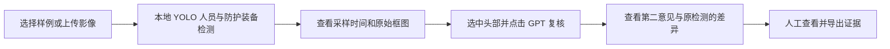

# 水电一局施工安全视觉 AI 演示项目任务书

版本：V1.0｜编制日期：2026-11-08｜功能基线：`e202213`
用途：明确本阶段交付范围、开发分工、依赖关系与验收标准。

## 1. 项目背景与需求依据

项目面向水电一局工程现场管理与领导汇报，目标是利用现有开源视觉应用，先完成一条能实际操作、能展示模型作用、能追溯原始依据的安全影像复核流程。

云枢源码因知识产权限制无法取得。本项目从独立代码与环境开始，优先复现已有开源应用、部署已有模型，只对确有需要的页面、接口、证据保存与启动方式做适配。标书、方案编制等 Agent 业务由其他项目承担。

需求依据包括原机《水电一局_AI应用需求交流会议纪要_11月3日.pdf》、前期调研材料，以及后续用户明确的演示方向。原始会议纪要属于内部资料，不随公开代码仓库分发。

### 1.1 原会议需求与本阶段的关系

会议纪要第 2 页的安全监测需求主要涉及设备与工程监测，后续用户又明确优先做实际有用的视觉 AI 演示。两者的承接关系如下。

| 需求来源与事项 | 当前承接方式 | 本阶段状态 | 后续依赖 |
| --- | --- | --- | --- |
| 纪要：真实设备采集、自动上传，减少人工转录和事后补填 | 为以后接入保留方向；当前影像记录只能证明影像处理过程 | 尚未接入真实监测设备 | 设备协议、真实报文、采样与上传时间、设备身份、存储和接口授权 |
| 纪要：顶拱应力、锚索受力、爆破振动及塌方相关信息联动，与业主第三方观测系统协同 | 待选定工点后另行验证 | 尚未实现 | 测点与工点映射、量纲、时间同步、第三方接口及工程判读依据 |
| 纪要：挖掘机后方 2 米范围内人员或障碍物感应预警 | 当前人员识别可供前置技术参考，未形成测距与预警系统 | 尚未实现 | 摄像头或传感器、后方区域定义、实际尺度标定、距离真值与现场安全验证 |
| 后续授权：优先展示照片/视频中的真实视觉 AI，重点安全监测 | 人员与个人防护装备初筛、所选头部 GPT 第二意见、人工查看与证据导出 | 当前主交付，已有实测基线 | 合法素材、固定权重、CPU 环境；GPT 复核另需本机 API 配置 |

本阶段任务是施工安全视觉 Demo。设备监测、工程风险联动和真实 2 米感应预警应单独立项验收，不能由 PPE 演示的通过状态代替。

## 2. 本阶段目标

交付一个面向领导演示和同事共同开发的可运行项目，使演示者能够：

1. 选择真实施工视频或照片，直接运行视觉模型识别人员、安全帽、反光背心及相关候选类别。
2. 查看实际检测框、原始类别与模型分数，定位到视频中的具体采样画面。
3. 对选中的头部调用 GPT 获取第二模型意见，展示一致、分歧或无法判断的情况。
4. 下载原始影像、输入画面、框图、JSON 与完整证据 ZIP。
5. 在新机器上按清单恢复资源和独立 CPU 环境，并通过 Git 协作修改源码。

演示可以按固定素材调参，也允许后续小规模微调及过拟合。训练或调参用过的样例必须注明用途，演示效果不写成独立现场准确率。检测框、模型分数和 GPT 回答须来自实际运行。

## 3. 使用对象与业务流程

主要对象为汇报演示者、安全管理业务人员、共同开发的同事。当前使用方式为本机浏览器处理照片或视频文件。

当前“人工复核”指查看、比较和留证，尚无人工结论录入、审核状态、整改派单或销项闭环。建议汇报时依次展示结构作业视频、清晰近景、砌筑照片的模型分歧，再展示下载证据，形成约 5～8 分钟的演示脚本；时长为编排建议。

## 4. 功能任务与验收标准

以下为本阶段交付基线；完成情况与证据见 [项目进度](VISUAL_PROGRESS.md)。

| 编号 | 任务 | 交付内容 | 验收标准 |
| --- | --- | --- | --- |
| F01 | 素材选择与上传 | 本地样例库与用户照片/视频上传入口；来源和许可展示 | 样例路径、字节数、SHA256 正确；当前库为 3 视频、3 照片；上传素材不套用样例作者或许可 |
| F02 | 人员与 PPE 检测 | 现成开源权重真实推理；自动推荐与手动模型选择 | 能对固定施工样例输出人员及安全帽框；显示真实类别、分数与来源；缺失或损坏权重明确失败，不用通用模型冒充 PPE 模型 |
| F03 | 视频采样与定位 | 从片头按范围和间隔抽帧；按时间选择结果 | 默认前 8 秒每 1 秒采样；范围可设 1～30 秒、间隔 0.5/1/2 秒；结果记录实际帧号与时间；部分处理失败不得伪报完成 |
| F04 | 原片画质保存 | 保留原始文件、原尺寸输入与框图，支持大图/对照 | 原文件 SHA 不变；保留画质模式下输入 PNG 像素等于对应解码帧，不增强、不预先降尺寸；下载与保存字节一致 |
| F05 | GPT 头部第二意见 | 选中直接头部检测框后手动调用，前台显示裁图与业务意见，真实来源写入调用证据 | 只发送未画框裁图和固定问题；默认 `gpt-6.1-sol` / `max`；记录真实回答、配置与耗用；原 YOLO 类别、分数、JSON 不改 |
| F06 | 失败处理与状态隔离 | 缺 Key 提示、调用失败记录、素材/模型切换隔离 | 无 Key 时检测与导出可用、复核禁用；状态查询不触网；失败无替代答案，可人工重试；切素材、检测模型或检测参数后不显示旧任务结果 |
| F07 | 证据导出 | 原件、采样输入、框图、原始 JSON、裁图与调用记录的 ZIP | 证据可与输入 SHA、模型版本及时间对应；复核成功或失败记录可追溯；Key 不进入状态、日志、Git 或证据包 |
| F08 | 水电一局演示页面 | 官方组合标识、本地样式、中文操作与结果说明 | 标识来源可查；桌面流程可操作，390 宽页面标识可见、无横向溢出；数量、耗时来自本次真实结果；“25 类”明确为目标标签数 |
| F09 | 安装、启动与协作 | CPU 环境安装、资源恢复、启动/停止脚本、Git 与交接文档 | 新目录可按清单恢复；项目环境隔离；只管理归属明确的本项目进程；资源按 SHA 校验；源码与模型/视频分离交接 |

### 4.1 关键口径

- SiteWatch 的 25 类包括人员、防护相关、机械设施与车辆；当前重点演示人员、安全帽与背心，不能据此称有 25 项安全业务。
- `NO-*` 是模型给出的待人工查看类别。未检出某装备不自动补造“未佩戴”；零检出也不能解释为安全。
- “待人工复核框”是跨采样帧累计的候选框次数，不是去重人数、独立事件数或已确认违规数。
- 视频结果是采样帧 PNG、时间与 JSON，当前没有连续逐帧叠框 MP4 成片输出。
- 原文件分辨率、保存画面尺寸、模型内部推理尺度、页面缩放分别记录。保存 4K 图像不表示模型以完整 4K 细节推理。
- GPT 目前只回答所选头部的 A 安全帽、B 可见头发/头皮、C 软帽、D 无法判断，不承担整视频通用隐患判断或自由追问。其文字意见没有校准置信概率。

## 5. 技术路线与复用要求

| 层次 | 当前技术与复用方式 | 约束 |
| --- | --- | --- |
| 页面与应用 | SiteWatch 原生 Streamlit 应用，增加水电一局品牌、中文交互和证据适配 | 保留上游源码、许可、固定版本与可重放 patch |
| 主检测 | Ultralytics YOLO；SiteWatch PPE 与 Constructelligence v0.3 现有权重 | 按固定素材实测选用；当前未新增训练 |
| 远景人员补充 | 官方 YOLOv8n COCO 模型，仅输出 person | 不输出安全帽判断；只对跨分支整人框做重叠过滤 |
| 影像处理 | OpenCV、NumPy、PNG 无损保存 | 原件保留；仅在明确关闭保真模式后允许有效增强/缩小 |
| 第二模型复核 | Python 标准库实现 Responses 图像接口，提交所选裁图 | 点击才调用；`store:false`；单次请求，不自动重发、不跟随重定向 |
| 证据与恢复 | JSON、ZIP、SHA256、路径白名单与文件大小核验 | 异内容目标拒绝覆盖；模型/素材必须有来源与许可 |
| 环境与协作 | Python venv、CPU PyTorch、Git/GitHub、Release 资源清单 | 只使用本项目环境；密钥、环境、模型和大视频不进 Git 历史 |

运行基线为 Ubuntu/WSL2、Linux x86_64、Python 3.12、glibc ≥ 2.28。当前使用 Torch 2.8.0+cpu、torchvision 0.23.0+cpu、Ultralytics 8.3.228、Streamlit 1.51.0。检测不要求 GPU；新训练的硬件与环境另行评估，不破坏已验收的 CPU 环境。

## 6. 范围与依赖

### 6.1 本阶段不包含的能力

现场摄像头/RTSP/ONVIF 接入、全天候连续监测、人员跟踪去重、自动告警与整改闭环、真实距离测量、烟火/跌倒/吊装动作判断、设备监测数据上传及业主系统联动，均不属于已完成的当前交付。上游保留的源码或清单中的其他候选模型不代表这些能力已经集成。

### 6.2 必要依赖

1. **输入资料**：有合法来源的施工照片/短视频；真实工点试用时另需代表性现场样例和业务判读。
2. **运行资源**：固定 PPE 权重、可选人员伴随权重、来源许可与素材清单。
3. **运行条件**：本项目独立 CPU 环境、足够磁盘、浏览器；首次依赖安装与资源恢复需网络或预先备齐离线资源。
4. **GPT 条件**：自己的兼容图像接口与本机 Key；只影响第二意见，基础检测可独立使用。
5. **开发条件**：指定 Git 仓库、功能分支、代码审查与对应验证证据。

## 7. 里程碑与完成判定

| 里程碑 | 前置依赖 | 完成判定 | 基线状态 |
| --- | --- | --- | --- |
| M0 范围与路线固定 | 用户确认视觉安全演示优先、云枢源码不可得 | 任务范围、开源来源、判断边界和验收方式明确 | 已形成；本文统一记录 |
| M1 开源应用与真实检测 | M0；模型、合法素材及 CPU 环境 | 原生应用能处理照片/短视频，真实结果与来源可导出 | 已验证 |
| M2 清晰视频与演示配置 | M1；固定演示素材清单 | 至少一条实际作业视频稳定展示人帽；原片保真；推荐配置与备用样例明确 | 已验证固定样例；仍有局部误检/重复框 |
| M3 GPT 与证据完整流程 | M1；GPT 配置与网络 | 用户点击复核、原答/分歧显示、失败记录和 ZIP 保持原检测 | 已有真实照片、视频调用及工程验证 |
| M4 演示运行与协作交付 | M2+M3；资源恢复脚本及版本固定 | 浏览器操作、启动与恢复、CPU 隔离、Git/资源包与验证记录可交接 | `e202213` 已交付；新机器仍按步骤验收 |
| O1 及后续优化 | M4；明确要改善的演示问题 | 按 [优化计划](VISUAL_OPTIMIZATION_PLAN.md) 逐项验证收益，再决定是否微调或扩范围 | 建议计划，尚未实施 |

依赖关系为 M0→M1→M2/M3→M4。优化阶段先解决可见的演示缺口；模型微调和新安全业务不与当前交付混写。

## 8. 工作规则与交付清单

主智能体负责架构、接口、集成、回归与进度；独立任务由子智能体处理。初期最多同时两个实现任务，并行写文件使用独立 branch/worktree，明确修改范围。完成任务时提交输入版本、命令、结果和证据；同因连续失败需记录原因并调整路线。

交付包括：

- 可运行源码、上游来源清单、许可证与适配 patch。
- 模型/素材版本清单、SHA、使用说明及恢复脚本。
- 运行、演示、API 配置和共同开发说明。
- 本任务书、[项目进度与技术说明](VISUAL_PROGRESS.md)、[下一步优化计划](VISUAL_OPTIMIZATION_PLAN.md)。
- 真实模型、API、浏览器、资源和环境验证摘要；大输出留本机，不重复提交历史截图。

用户原有训练与验收视频必须保留；清理与迁移先核对保护清单。当前已删除本地千问模块、权重和 full 路线，不恢复成隐含依赖。API Key 仅写本机忽略文件。

本任务书描述已确认的当前项目及后续承接边界，不代替设备安全系统或生产部署的专项方案。实际完成事实与证据以 [项目进度](VISUAL_PROGRESS.md) 和 `docs/validation/` 为准。
